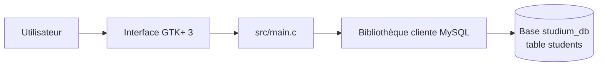

<div align="center">

# studium_db

### Gestion des étudiants : une application de bureau en C, GTK+ 3 et MySQL


*Mini-projet du module Algorithmique et Programmation C (1er semestre)*
*Encadré par le Pr. Hakim El Massari*

</div>

---

## Sommaire

- [Présentation](#présentation)
- [Fonctionnalités](#fonctionnalités)
- [Architecture](#architecture)
- [Prérequis](#prérequis)
- [Installation](#installation)
- [Configuration](#configuration)
- [Utilisation](#utilisation)
- [Structure du projet](#structure-du-projet)
- [Dépannage](#dépannage)
- [Outils utilisés](#outils-utilisés)
- [Contribuer](#contribuer)
- [Licence](#licence)
- [Auteurs](#auteurs)

---

## Présentation

**studium_db** est une application de bureau qui permet de gérer une liste d'étudiants depuis une interface graphique simple. Elle est écrite en **C** avec **GTK+ 3** pour l'interface et **MySQL** pour le stockage des données.

Le projet met en pratique les notions du module : programmation modulaire en C, manipulation de chaînes, gestion des erreurs, et accès à une base de données depuis un programme natif.

## Fonctionnalités

| Action | Description |
|---|---|
| **Ajouter** | Enregistre un nouvel étudiant (nom et CNE obligatoires) |
| **Modifier** | Met à jour les informations d'un étudiant identifié par son CNE |
| **Supprimer** | Supprime un étudiant à partir de son CNE |
| **Rechercher** | Recherche par CNE (exact) ou par nom (partiel) |
| **Afficher tout** | Liste tous les étudiants dans la fenêtre |

**Champs gérés :** nom, prénom, CNE, date de naissance, ville, adresse, compte académique, filière, année d'étude.

## Architecture



L'interface GTK+ récupère les champs saisis, `main.c` exécute les requêtes correspondantes à chaque action, et les résultats sont affichés dans la zone de texte de la fenêtre.

## Prérequis

- Compilateur **GCC**
- **GTK+ 3** (paquets de développement)
- **MySQL** ou **MariaDB** (serveur + bibliothèque cliente de développement)
- `make` et `pkg-config`

**Debian / Ubuntu :**

```bash
sudo apt install build-essential pkg-config libgtk-3-dev libmysqlclient-dev mysql-server
```

**Windows :** utilisez MSYS2 :

```bash
pacman -S mingw-w64-x86_64-gtk3 mingw-w64-x86_64-libmariadbclient
```

ou l'environnement Code::Blocks avec GTK+ configuré.

## Installation

```bash
# Cloner le dépôt
git clone https://github.com/<votre-compte>/studium-db.git
cd studium-db

# 1. Créer la base et la table
mysql -u root -p < schema.sql

# 2. Compiler
make
```

## Configuration

La connexion à la base se règle par variables d'environnement (valeurs par défaut entre parenthèses) :

| Variable | Rôle | Défaut |
|---|---|---|
| `DB_HOST` | Hôte MySQL | `localhost` |
| `DB_PORT` | Port | `3306` |
| `DB_USER` | Utilisateur | `root` |
| `DB_PASSWORD` | Mot de passe | *(vide)* |
| `DB_NAME` | Nom de la base | `studium_db` |

Exemple :

```bash
DB_USER=etu DB_PASSWORD=secret ./studium_db_app
```

Un modèle est fourni dans `.env.example`.

> **Sécurité :** ne commitez jamais vos vrais identifiants. Vérifiez que votre fichier `.env` est bien listé dans `.gitignore`.

## Utilisation

```bash
./studium_db_app
```

1. Remplissez les champs puis cliquez sur **Ajouter**.
2. Pour **Modifier**, **Supprimer** ou **Rechercher**, renseignez le CNE (ou le nom pour la recherche).
3. **Afficher tout** liste les étudiants dans la zone du bas.

## Structure du projet

```
studium-db/
├── src/main.c        # Code source de l'application
├── schema.sql        # Création de la base et de la table students
├── Makefile          # Compilation
├── .env.example      # Modèle de configuration
├── LICENSE           # Licence MIT
└── README.md
```

## Dépannage

| Problème | Piste de solution |
|---|---|
| `gtk/gtk.h: No such file or directory` | Installer `libgtk-3-dev` et vérifier que `pkg-config --cflags gtk+-3.0` fonctionne |
| `mysql/mysql.h: No such file or directory` | Installer `libmysqlclient-dev` (ou `libmariadb-dev` avec MariaDB) |
| `Access denied for user` | Vérifier `DB_USER` et `DB_PASSWORD`, puis les droits de l'utilisateur sur la base |
| `Can't connect to MySQL server` | Vérifier que le serveur est démarré et que `DB_HOST` et `DB_PORT` sont corrects |
| `Unknown database 'studium_db'` | Exécuter `mysql -u root -p < schema.sql` avant de lancer l'application |

## Outils utilisés

| Outil | Rôle |
|---|---|
| Code::Blocks | IDE |
| MySQL | SGBD |
| GTK+ | Interface graphique |
| GCC | Compilateur |
| GDB | Débogueur |

## Contribuer

Les suggestions sont les bienvenues : forkez le dépôt, créez une branche, committez vos changements, puis ouvrez une pull request.

## Licence

Ce projet est distribué sous licence **MIT**. Vous pouvez l'utiliser, le modifier et le redistribuer librement, à condition de conserver la mention de copyright. Voir le fichier [LICENSE](LICENSE) pour le texte complet.

## Auteurs

- Boudallaa Samah
- El Bahloul Chaymae
- Khadija El Basri
- Yassamine Obba
- Khadija Rizqy

**Encadrant :** Pr. Hakim El Massari
